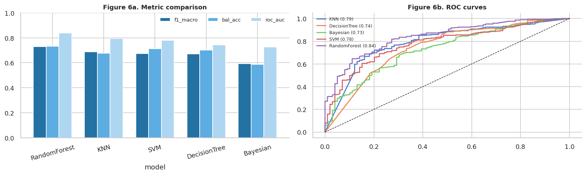
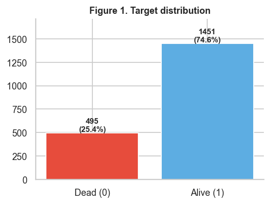
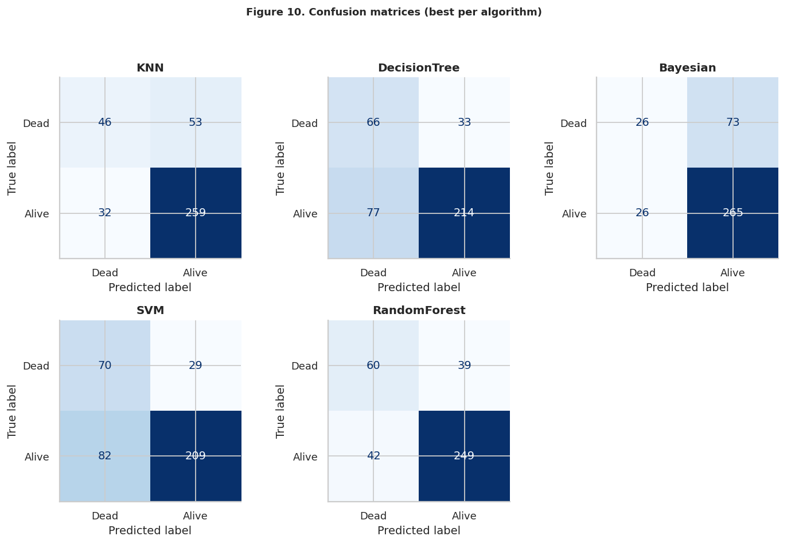
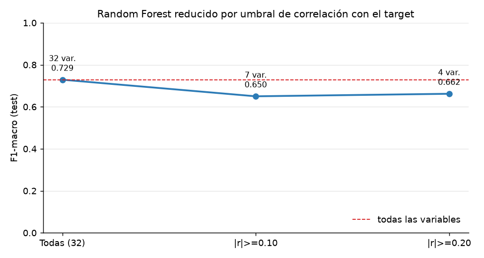

# Valar morghulis: ¿quién sobrevive en Game of Thrones?

> Todos los hombres deben morir… pero ¿cuáles? Cinco clasificadores clásicos se enfrentan a 1 946
> personajes para averiguarlo, y el primer enemigo no es el modelo, sino un dataset que trae la
> respuesta escondida en sus columnas.

Clasificación binaria (vivo/muerto) de 1 946 personajes de *A Song of Ice and Fire* con K-NN, árbol
de decisión, Naive Bayes, SVM y Random Forest en scikit-learn: eliminación de fugas de información,
25 configuraciones comparadas con validación cruzada, evaluación completa en test y un estudio de
cuántas variables hacen falta realmente.

| Modelo (mejor configuración) | CV F1-macro | Test F1-macro | Recall "muerto" | ROC-AUC |
|---|---|---|---|---|
| **Random Forest** (300 árboles, prof. 12) | **0.730** | **0.729** | 0.606 | **0.839** |
| K-NN (k = 5, ponderado por distancia) | 0.656 | 0.689 | 0.465 | 0.793 |
| SVM (RBF, C = 5) | 0.689 | 0.674 | **0.707** | 0.780 |
| Árbol de decisión (hoja mín. 5) | 0.673 | 0.670 | 0.667 | 0.744 |
| Naive Bayes (Bernoulli, α = 0.5) | 0.638 | 0.593 | 0.263 | 0.728 |



---

## Índice

- [Las reglas del juego](#las-reglas-del-juego)
- [Datos](#datos)
- [Método](#método)
- [Resultados](#resultados)
- [Lo que me llevo](#lo-que-me-llevo)
- [Siguientes pasos](#siguientes-pasos)
- [Cómo ejecutarlo](#cómo-ejecutarlo)

---

## Las reglas del juego

- **Fugas eliminadas antes de modelar.** El dataset trae columnas que contienen la respuesta (`actual`,
  `alive`), predicciones de un modelo anterior (`pred`, `plod`) y `DateoFdeath`, que solo existe si el
  personaje ha muerto. Con ellas cualquier modelo acierta casi el 100 %; sin ellas, el problema es real.
- **Selección por validación cruzada, test usado una sola vez.** La CV (0.730) y el test (0.729) del
  Random Forest casi coinciden: la elección no está sesgada hacia el test.
- **F1-macro como métrica principal.** Con un 74.6 % de vivos, predecir siempre "vivo" ya da 0.75 de
  accuracy; F1-macro y el recall de la clase minoritaria cuentan la historia real.
- **Naive Bayes adaptado a los datos.** Casi todas las variables son binarias, así que se comparó la
  versión gaussiana con la de Bernoulli; ganó Bernoulli.

## Datos

`got_dataset.csv` (incluido): 1 946 personajes y 33 columnas, entre ellas libros en los que aparece,
casa, cultura, nobleza, género, popularidad y número de familiares muertos. Target: `isAlive`.



## Método

1. **EDA de descubrimiento**, sin modificar los datos: tipos, nulos, distribuciones y relación de cada
   variable con el target (χ² con p-values para género y nobleza, tasas de supervivencia por casa).
2. **Preparación:** eliminación de fugas e identificadores, codificación de categóricas agrupando
   niveles raros y detección de redundancias (`isMarried` duplica la información de `spouse`).
3. **Split 80/20 estratificado:** deja ~99 personajes muertos en test, suficientes para medir el recall
   de esa clase.
4. **5 algoritmos × 5 configuraciones** elegidas con CV 5-fold y F1-macro
   ([`figures/table_all_configs.csv`](figures/table_all_configs.csv)).
5. **Evaluación en test** del mejor de cada algoritmo: matriz de confusión, métricas por clase y ROC.
6. **Reducción de variables** con el mismo modelo, los mismos hiperparámetros y el mismo test.

## Resultados

### Matrices de confusión



La fila "Dead" son los personajes que de verdad murieron. El Random Forest acierta 60 de 99. El SVM
detecta más muertos (70) a cambio de más falsas alarmas: si lo que más importa es no dejar escapar
ninguna muerte, el SVM es la mejor opción; si se busca el mejor equilibrio, el Random Forest.

### Cuántas variables hacen falta

Se reentrenó el mismo Random Forest, con los mismos hiperparámetros y sobre el mismo test, quedándose
solo con las variables cuya correlación con el target supera cada umbral:

| Subconjunto | Nº de variables | Test F1-macro |
|---|---|---|
| Todas las variables | 32 | **0.729** |
| \|r\| ≥ 0.10 | 7 | 0.650 |
| \|r\| ≥ 0.20 | 4 | 0.662 |
| \|r\| ≥ 0.25 | 1 | — |



La correlación lineal con el target no es un buen criterio para elegir las variables de un Random
Forest: deja fuera variables poco correlacionadas por sí solas que el modelo sí aprovecha a través de
interacciones. El conjunto completo de 32 variables es el que mejor generaliza.

### Qué variables importan

Las más relacionadas con la supervivencia son `book4` (aparecer en el cuarto libro, |r| = 0.27), la
cultura valyria (0.22), el número de familiares muertos (0.20), la popularidad (0.20) y la casa
Targaryen (0.18). Son correlaciones débiles por separado, y por eso ganan los modelos que combinan
muchas variables.

## Lo que me llevo

- El **Random Forest** es el mejor modelo global (F1-macro 0.729, ROC-AUC 0.839) y el **SVM** el que
  más muertes detecta.
- Eliminar las fugas es la decisión que más cambia el resultado: separa un modelo que memoriza la
  respuesta de uno que aprende patrones.
- Las variables útiles para el Random Forest no son necesariamente las más correlacionadas con el
  target: reducir por correlación lineal cuesta 7–8 puntos de F1-macro.

## Siguientes pasos

- Ajustar el umbral de decisión del Random Forest para subir el recall de la clase "muerto".
- Analizar interacciones explícitas (noble × género × casa) con tasas de supervivencia por grupo.
- Seleccionar variables por importancia (o por permutación) en lugar de por correlación lineal.
- Probar *gradient boosting* (XGBoost/LightGBM) con la misma validación.

## Cómo ejecutarlo

Python 3.10+ con `pandas`, `numpy`, `scikit-learn`, `scipy`, `matplotlib` y `seaborn`.

```
got_supervivencia.ipynb   notebook completo (EDA → fugas → 5 modelos con CV → evaluación → reducción)
got_dataset.csv           dataset
memoria.pdf               memoria del proyecto
figures/                  figuras y tablas exportadas
```

---

Proyecto desarrollado durante el Grado en Ingeniería de Sistemas de Inteligencia Artificial
(Universidad Francisco de Vitoria, 2025/26). Autor: Marco Larriba Rius.
